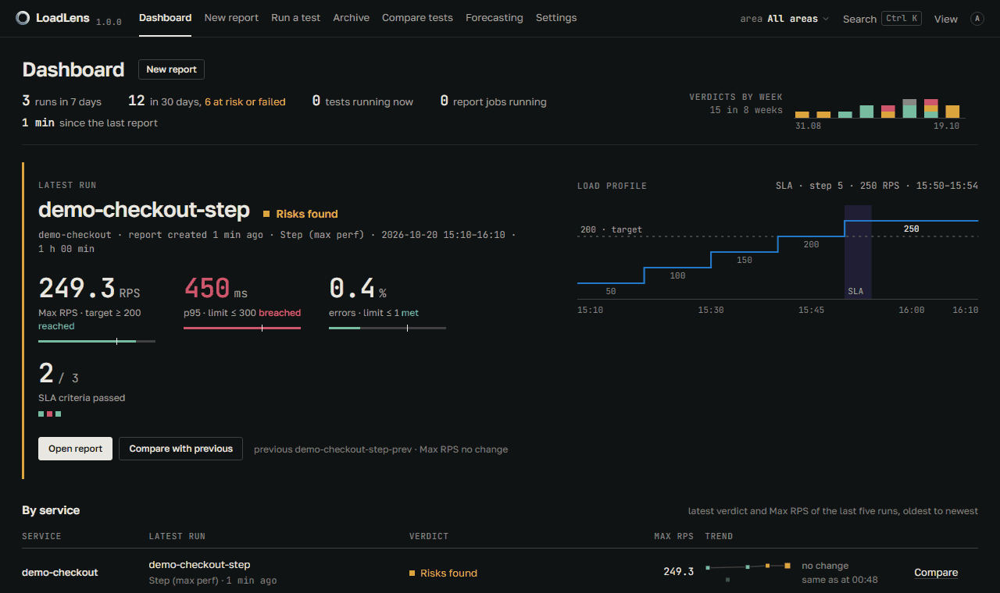
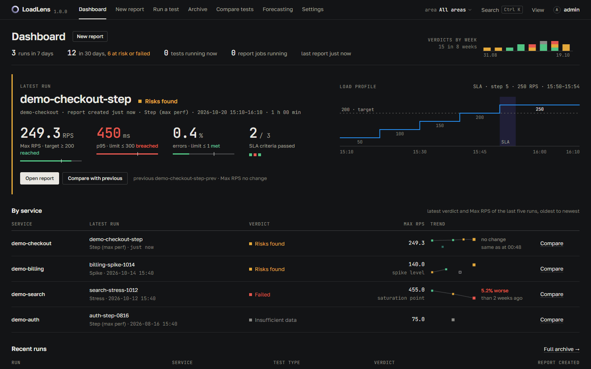
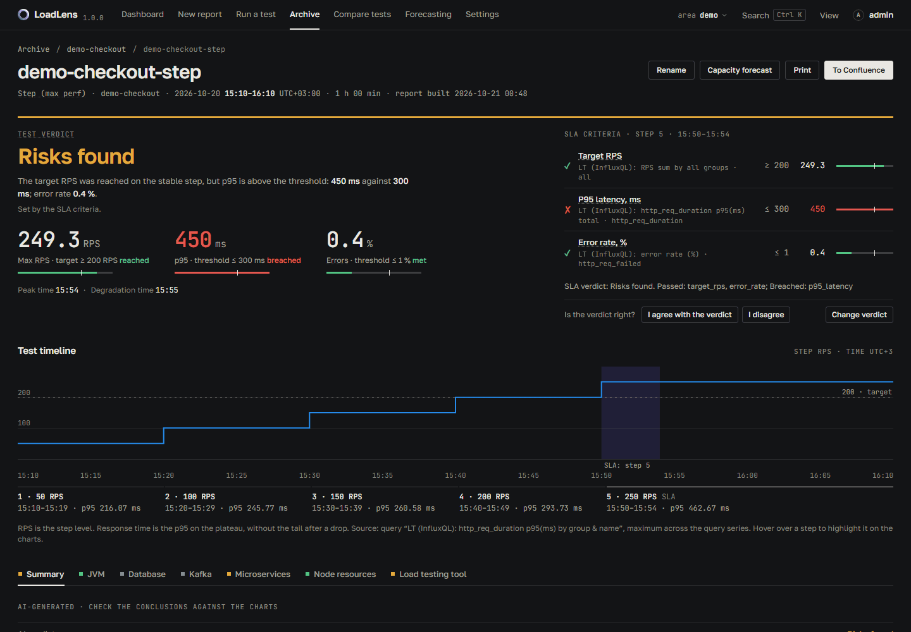

<p align="center">
  
</p>

<h1 align="center">LoadLens</h1>

<p align="center">
  Load test reports from the metrics you already collect: load steps, SLA verdicts, AI analysis checked against the data,<br/>
  run comparison and capacity forecasts in one web UI.
</p>

<p align="center">
  <a href="https://github.com/Zagato27/LoadLens/actions/workflows/tests.yml"></a>
  <a href="https://github.com/Zagato27/LoadLens/releases"></a>
  <a href="LICENSE"></a>
  
  <a href="https://github.com/Zagato27/LoadLens/pkgs/container/loadlens"></a>
</p>

<p align="center"><a href="README.ru.md">Русская версия</a></p>



## Why LoadLens

- **The whole test window from your own metrics.** LoadLens reads Prometheus, VictoriaMetrics or InfluxDB (directly or through Grafana), stores the series of every run in TimescaleDB and builds the report from the test's own data: load tool, JVM, databases, Kafka, services, nodes, load generators, application logs.
- **Deterministic steps and SLA verdicts.** A step detector finds the plateaus, the stable maximum and the moment the load drops; the SLA check on the last stable step (target RPS, error ratio, p95/p99, CPU, memory) gives `pass`, `risk`, `fail` or `no_data` with the threshold, the fact and the status of every criterion. No model is involved in the verdict.
- **AI analysis per domain, every number checked.** Each domain gets its own analysis; several candidates are scored by a judge, and every number in the findings is verified against the collected data before the report says it. Step, soak, spike and stress tests each get their own analysis.
- **Compare runs and forecast capacity.** Two runs side by side with an automatically chosen baseline, and a Universal Scalability Law forecast: the limit, the safe maximum and the number of pods for a target load.
- **Launch tests and publish.** Start k6, JMeter, Locust or Gatling on SSH, Docker, Kubernetes, GitLab CI or Jenkins generators with live RPS, errors and p95, then publish the report and the forecast to Confluence.

## Quick start

The demo needs Docker only: an LLM stub and a Prometheus stub run inside the stack, no API keys or external systems.

```bash
docker compose -f docker/docker-compose.demo.yml --env-file docker/demo.env --profile demo up --build
```

Open http://localhost:5000 and sign in with `admin` / `loadlens-demo`. The UI opens in English with a "Demo data" banner. Within a minute or two the dashboard shows the `demo-checkout` service with two runs: `demo-checkout-step`, a seeded run, and `demo-checkout-step-2`, a report built by the real pipeline against the two stubs, so the SLA table, the steps, the charts, the AI tabs with their verification, the archive, the comparison and the capacity forecast are all filled. `--env-file` is part of the command: without it Docker Compose would read `docker/.env` of a production install. Stop and remove the demo data:

```bash
docker compose -f docker/docker-compose.demo.yml --env-file docker/demo.env --profile demo down -v
```

### Run it with your data

```bash
cp docker/env.example docker/.env                   # database, Redis, admin user, secret key
cp settings.example.py settings.py                  # storage, data sources, LLM, SLA (commented)
cp metrics_config.example.py metrics_config.py
echo '{}' > settings_runtime.json && echo '{}' > metrics_config_runtime.json
cd docker && docker compose up -d --build           # app, TimescaleDB, Redis, Celery worker
```

Open http://localhost:5000, sign in with the administrator from `docker/.env` and run the wizard at `/settings?wizard=1`: storage, data sources, domain bindings, query packs for your stack, LLM and SLA, each connection checked before you save. Tagged releases publish the image `ghcr.io/<owner>/loadlens:<tag>` (and `:latest`) for linux/amd64 and linux/arm64; [docs/deployment.md](docs/deployment.md#https-with-caddy) puts it behind HTTPS with Caddy. Details: [docs/getting-started.md](docs/getting-started.md), [docs/deployment.md](docs/deployment.md).

## What it works with

| | |
|---|---|
| Load tools | k6, Gatling, JMeter, Locust, Yandex.Tank through their metrics output (k6 to InfluxDB or Prometheus remote write, JMeter to InfluxDB, Gatling Graphite to InfluxDB or VictoriaMetrics, Locust exporter, Yandex.Tank InfluxUploader); any tool whose metrics land in a supported store, with a command template for launching it |
| Metric stores | Prometheus (PromQL), VictoriaMetrics (PromQL), InfluxDB 1.x (InfluxQL) and 2.x (Flux), each directly or through a Grafana data source proxy |
| Query packs | 41 packs with checked queries and SLA references: node_exporter, windows_exporter, kube-state-metrics, JVM (Micrometer, JMX exporter, OpenTelemetry), Go, Python (FastAPI, Flask, Django), HTTP (Micrometer, Go, OpenTelemetry, NGINX ingress, Istio), Kafka (kafka_exporter, broker JMX, client Micrometer), PostgreSQL, PgBouncer, MySQL, MongoDB, Redis, ArangoDB, HikariCP, load generators |
| Launching tests | SSH (pinned host key), Docker Engine API, Kubernetes Jobs, GitLab CI and Jenkins pipelines with their parameters, or a manual mode that only marks the window |
| LLM providers | Perplexity, OpenAI-compatible APIs, Anthropic, GigaChat (mTLS) |
| Outputs | Web reports (print to PDF), Confluence pages for the report and the forecast, REST API with tokens for CI |
| Logs | OpenSearch: aggregated ERROR logs of the test window as an optional domain |
| Storage | TimescaleDB (PostgreSQL 14+ with the extension); Redis and a Celery worker are optional, reports run in a thread otherwise |
| Sign-in | Local users with roles (viewer, engineer, administrator), API tokens, audit log, LDAP or OIDC through the `AuthProvider` interface, a recovery mode while the database is down |
| UI languages | English and Russian; the language of reports and prompts is a setting of the installation |

## How it works

1. **Collect.** For the test window LoadLens runs the queries of every domain against its data source and stores the series in TimescaleDB, so the report can be rebuilt, compared and forecast later.
2. **Steps.** The step detector works on the assigned RPS series: plateaus of every step, the stable maximum, the moment the load drops; short dips with recovery are not a drop.
3. **SLA.** A deterministic check on the last stable step (the hold window for soak tests, the spike windows for spike tests): target RPS, error ratio, p95/p99, CPU and memory of the nodes. The verdict is `pass`, `risk`, `fail` or `no_data`.
4. **AI analysis.** Each domain gets a prompt with its data, the test profile and a structured description of the system under test; the model answers in strict JSON, several candidates are scored by a G-Eval-lite judge.
5. **Verification.** Every number in the findings is checked against the collected data; the report shows which numbers were confirmed and how the answer was chosen. Findings can be voted on, and an engineer can override the verdict with a reason.
6. **Report.** SLA table, steps, charts with the step zones and thresholds, domain tabs, the overall verdict with its rationale, the engineer summary; a Confluence page that repeats it, and a capacity forecast built from the steps.

More in [docs/ai-analysis.md](docs/ai-analysis.md).

## Screenshots

The interface is built like an instrument: a top bar instead of a sidebar, tables and charts without cards, figures
in a monospaced face and color only where it means a status. The first screen of a report says it in plain words:
the verdict, one sentence with the figures that explain it, the key numbers against their thresholds, the SLA
criteria and the test timeline with its steps. The dashboard opens with a status line and the latest run with its
load profile; the archive shows SLA n/m and p95 for every run. The light and the dark theme are equal; until you pick
one, the theme follows the system.





More screenshots (AI analysis, charts, archive, comparison, forecast, settings; Russian UI) are in [README.ru.md](README.ru.md).

## Configuration

`settings.py` (start from `settings.example.py`, every section is commented) holds the storage, the catalogue of data sources and their domain bindings, the queries, the SLA thresholds, the LLM provider, Confluence, limits, load generators and the description of the system under test. Changes made in the UI are saved to `settings_runtime.json` and `metrics_config_runtime.json` and apply without a restart; project areas and services override queries, SLA, prompts and context. Authentication and the job runner are set with environment variables. See [docs/configuration.md](docs/configuration.md) and [docs/data-sources.md](docs/data-sources.md).

## Development

```bash
pip install -r requirements-dev.txt
cp settings.example.py settings.py && cp metrics_config.example.py metrics_config.py
python -m pytest -q                      # offline; LOADLENS_REQUIRE_NODE=1 makes the JS tests fail instead of skip without Node 22
```

CI: `tests.yml` runs the suite on every push and pull request, `dependency-audit.yml` runs pip-audit and a license check, `demo.yml` starts the demo stack end to end, and `release.yml` builds the image and the GitHub Release from a `v*` tag. UI and server texts live in `locales/<lang>/<namespace>.json`; every key must exist in both `ru` and `en`, tests run with missing keys as errors, and `tools/i18n_extract.py` keeps Russian literals out of the code. See [docs/development.md](docs/development.md).

## Roadmap

Finished work is listed in [CHANGELOG.md](CHANGELOG.md). Next on the list:

- More query packs: JMeter with the Prometheus listener, Kafka Burrow, and live-stack verification of the 21 packs that are only checked syntactically today (among them Windows, MySQL, MongoDB, Istio, NGINX ingress, JMX exporter, OpenTelemetry, kube-state-metrics and the InfluxQL packs of JMeter, Gatling and Yandex.Tank).
- Local models through OpenAI-compatible servers as a documented, tested path, and more providers.
- Import of Grafana dashboards as the starting point of a domain's queries.
- A quality pass of the English prompts and reports on real providers.

Suggestions and use cases are welcome in Discussions; the pinned roadmap issue tracks what is in progress.

## Contributing

Contributions are accepted under the [Developer Certificate of Origin](https://developercertificate.org/): sign your commits with `git commit -s`. [CONTRIBUTING.md](CONTRIBUTING.md) covers the setup, the tests, the i18n rules and the pull request checklist; issues labelled `good first issue` are a good place to start.

## Security

Report vulnerabilities privately as described in [SECURITY.md](SECURITY.md). Never commit `settings.py`, the runtime JSON files or `docker/.env`. LoadLens does not phone home: it talks only to the systems you configure (metric stores, Confluence, OpenSearch, the LLM provider), and the LLM provider is the only one that receives test data for analysis.

## License

[Apache License 2.0](LICENSE). The copyright notice is in [NOTICE](NOTICE), the bundled third-party components and their licenses in [THIRD_PARTY_NOTICES.md](THIRD_PARTY_NOTICES.md). The LoadLens name and logo are not covered by the license: see [TRADEMARK.md](TRADEMARK.md).

## Community

- GitHub Issues for bugs and feature requests (templates ask for the version from `/about`).
- GitHub Discussions for questions, setups and ideas.
- Russian documentation: [README.ru.md](README.ru.md).
